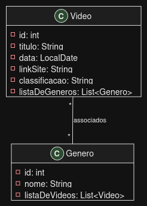

# 🎬 FrameStack — Sistema de Videoteca (POO / IFPB)

Projeto desenvolvido para a disciplina de **Programação Orientada a Objetos (POO 2026.2)** — **IFPB Campus João Pessoa**, ministrada pelo **Prof. Fausto Ayres**.

O sistema gerencia uma videoteca com catálogo de filmes e gêneros, implementando relacionamento bidirecional Muitos-para-Muitos (N:N) e persistência em banco de dados orientado a objetos **Db4o**.

---

## 📊 Diagrama de Classes (UML)



- **Video**: `id: int`, `titulo: String`, `data: String` (dd/MM/yyyy), `linkSite: String`, `nota: double`, `listaDeGeneros: List<Genero>`
- **Genero**: `id: int`, `nome: String`, `listaDeVideos: List<Video>`
- **Associação**: `Video "*" -- "*" Genero` (associação bidirecional)

---

## 🏗️ Estrutura do Projeto

```text
pooProject/
├── .gitignore
├── add_opens.txt              # Argumentos de JVM para execução no Java 9+
├── README.md
├── docs/
│   ├── ROTEIRO_APRESENTACAO.md # Roteiro de falas e guia para a apresentação
│   ├── Videoteca.UML.v1.drawio.pdf
│   ├── Videoteca.UML.v1.drawio.puml
│   └── img/
├── lib/
│   └── db4o-all-8.0.249.jar   # Biblioteca Db4o
└── src/
    ├── Main.java              # Teste das classes de negócio em memória
    ├── modelo/                # Pacote de negócio
    │   ├── Genero.java
    │   └── Video.java
    ├── util/                  # Utilitários de persistência fornecidos na aula
    │   ├── GeradorID.java     # Geração automática de chaves primárias sequenciais
    │   └── Util.java          # Conexão e configuração do banco (framestack.db4o)
    └── appconsole/            # Aplicações CRUD em console (2ª Etapa)
        ├── Cadastrar.java     # 1. Cadastra objetos no banco com seus relacionamentos
        ├── Listar.java        # 2. Lista todos os objetos e seus relacionamentos
        ├── Alterar.java       # 3. Remove relacionamento existente entre dois objetos
        ├── Apagar.java        # 4. Apaga um objeto que possui relacionamento(s)
        └── Visualizar.java    # Bônus: visualizador gráfico em árvore do banco Db4o
```

---

## 🚀 Como Executar

### 1. Compilação
Abra o terminal na pasta raiz do projeto e execute:

```powershell
javac -cp "lib/db4o-all-8.0.249.jar;src" -d bin src/modelo/*.java src/util/*.java src/appconsole/*.java src/Main.java
```

### 2. Executando as Aplicações CRUD

Devido ao sistema de módulos do Java moderno (Java 9+), utilize o arquivo `@add_opens.txt` para liberar a introspecção por reflexão necessária pelo Db4o:

#### **Passo 1: Cadastrar objetos**
```powershell
java @add_opens.txt -cp "lib/db4o-all-8.0.249.jar;bin" appconsole.Cadastrar
```

#### **Passo 2: Listar objetos e relacionamentos**
```powershell
java @add_opens.txt -cp "lib/db4o-all-8.0.249.jar;bin" appconsole.Listar
```

#### **Passo 3: Alterar (Remover Relacionamento)**
Remove o relacionamento N:N entre o filme 'Matrix' e o gênero 'Ficção Científica':
```powershell
java @add_opens.txt -cp "lib/db4o-all-8.0.249.jar;bin" appconsole.Alterar
```

#### **Passo 4: Apagar (Excluir Objeto com Relacionamento)**
Desfaz os vínculos com os gêneros e apaga o filme 'Forrest Gump' de forma segura sem cascata:
```powershell
java @add_opens.txt -cp "lib/db4o-all-8.0.249.jar;bin" appconsole.Apagar
```

#### **Passo 5: Visualizador Gráfico (Opcional)**
```powershell
java @add_opens.txt -cp "lib/db4o-all-8.0.249.jar;bin" appconsole.Visualizar
```

---

## 🎤 Roteiro de Apresentação
O roteiro completo com divisão de falas, explicações técnicas e respostas para as perguntas do professor está disponível em:
👉 **[docs/ROTEIRO_APRESENTACAO.md](docs/ROTEIRO_APRESENTACAO.md)**